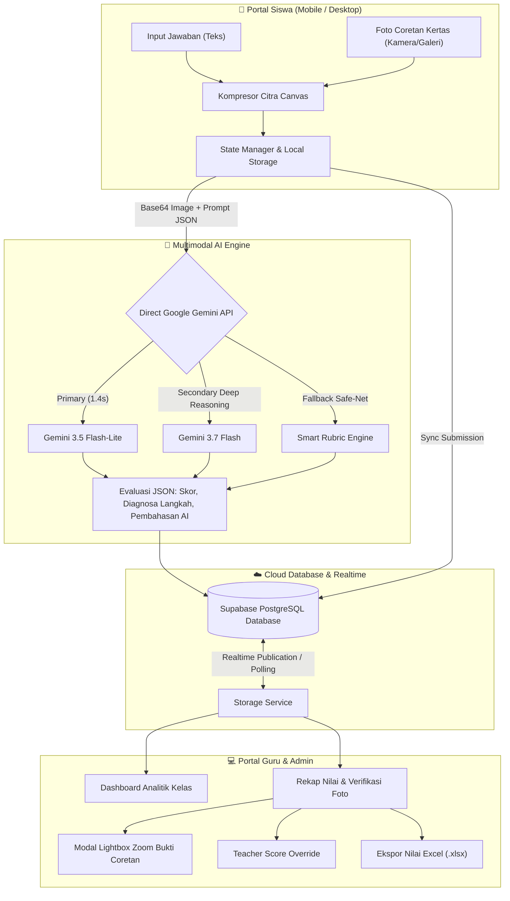

<div align="center">

# 📐 Fun Math World
### *Next-Generation Gamified Math Learning Platform with Multimodal AI Vision*

[](https://react.dev/)
[](https://www.typescriptlang.org/)
[](https://vitejs.dev/)
[](https://tailwindcss.com/)
[](https://ai.google.dev/)
[](https://supabase.com/)
[](https://threejs.org/)

<p align="center">
  <b>Platform edukasi matematika interaktif modern berbasis Neobrutalisme untuk materi Operasi Pecahan (Kurikulum Merdeka Kelas 7 SMP).</b><br/>
  Dilengkapi mesin evaluasi cerdas <b>Google Gemini Multimodal Vision</b> yang mampu membaca dan mengoreksi tulisan tangan siswa pada lembar coretan fisik secara real-time.
</p>

[✨ Fitur Unggulan](#-fitur-unggulan) •
[🏛️ Arsitektur Sistem](#️-arsitektur-sistem) •
[👥 Ekosistem Portal](#-ekosistem-tiga-portal) •
[🛠️ Tech Stack](#️-tech-stack--teknologi) •
[🚀 Cara Menjalankan](#-panduan-instalasi--menjalankan) •
[📸 Tinjauan Fitur](#-tinjauan-fitur-kunci)

---

</div>

## 💡 Latar Belakang & Deskripsi Proyek

**Fun Math World** dikembangkan untuk mentransformasi pengalaman belajar matematika siswa SMP yang sering dianggap abstrak dan membosankan menjadi pengalaman digital yang interaktif, menantang, dan menyenangkan (*gamified*).

Mengusung pendekatan **Kurikulum Merdeka** berorientasi pada **Higher-Order Thinking Skills (HOTS)**, aplikasi ini tidak hanya menguji hasil akhir angka, melainkan membimbing penalaran konseptual siswa melalui model pemecahan masalah bertahap (C3 Menerapkan, C4 Menganalisis, hingga C5 Mengevaluasi).

Tantangan terbesar dalam pembelajaran digital matematika adalah bagaimana memeriksa **proses berpikir dan coretan tangan siswa di buku tulis**. Fun Math World menjawab tantangan ini dengan mengintegrasikan **Google Gemini Multimodal AI**, memungkinkan siswa memotret lembar pengerjaan fisik mereka langsung dari ponsel, sementara AI mentranskripsi, menganalisis langkah perhitungannya, serta memberikan diagnosa bimbingan personal secara instan.

---

## ✨ Fitur Unggulan

### 🧠 1. Asisten Koreksi AI Multimodal Vision (Google Gemini)
* **Pemeriksaan Dual-Input (Teks & Coretan Foto)**: Siswa dapat mengetik uraian digital, mengunggah foto lembar coretan buku tulis (via kamera langsung atau galeri ponsel), atau keduanya.
* **OCR Coretan Tangan Matematis**: Mampu membaca simbol pecahan, pembagian bertingkat, coretan penyederhanaan, dan penyamaan penyebut (KPK) dari tulisan pensil/pulpen siswa.
* **Diagnosa Konseptual Spesifik**: AI tidak sekadar memberi nilai benar/salah, melainkan **menyebutkan (*mention*) secara rinci apa yang tertulis di kertas siswa** dan membongkar miskonsepsi (misalnya: menjumlahkan penyebut secara langsung vs menyamakan penyebut via KPK).
* **Deteksi Relevansi Cerdas**: Secara otomatis mengenali jika gambar yang dilampirkan buram atau di luar konteks pecahan SMP (seperti lembar kuliah/foto sembarang) dan memberikan nilai objektif 0 poin beserta teguran edukatif.
* **Multi-Model Failover & Resilient Timeout**: Rantai model cerdas berkasitas tinggi (`gemini-3.5-flash-lite`, `gemini-3.7-flash`, `gemini-3-flash-preview`) dengan batas waktu respons adaptif dan *fallback* Smart Rubric offline.

### 🎮 2. Visualisasi Interaktif & 3D Gamification
* **Simulasi Pecahan 3D**: Menggunakan *Three.js* & *React Three Fiber* untuk memvisualisasikan representasi pembagian balok dan irisan bidang ruang.
* **Neobrutalism UI Design**: Estetika modern dengan garis batas kontras tebal, palet warna berani (*high vibrancy*), tipografi ekspresif, dan responsivitas sempurna di laptop maupun smartphone.
* **Audio & Haptic Feedback**: Efek suara interaktif sintetis (*soundService*) untuk aksi klik, notifikasi benar/salah, hingga perayaan konfeti (*canvas-confetti*).

### 🛡️ 3. Sistem Integritas & Anti-Cheat Cerdas
* **Tab-Switching Monitor**: Mendeteksi dan mencatat frekuensi siswa berpindah tab browser atau meminimalkan layar selama pengerjaan LKPD dan Evaluasi.
* **Integritas Penilaian Guru**: Laporan jumlah pelanggaran perpindahan tab disematkan langsung pada rekapitulasi nilai guru untuk menjamin kejujuran ujian online.

### ☁️ 4. Sinkronisasi Cloud Real-Time & Offline-First
* **Supabase Realtime Cloud**: Sinkronisasi instan antara laptop guru dan smartphone siswa di kelas tanpa perlu *refresh* manual.
* **Penyimpanan Lokal Resilien**: Jawaban draf, lampiran foto, dan riwayat pengerjaan otomatis tersimpan di `localStorage` per perangkat sehingga tidak hilang saat koneksi internet terputus.

---

## 🏛️ Arsitektur Sistem

Alur interaksi dari siswa mengerjakan tugas, pemrosesan citra oleh Gemini AI, hingga sinkronisasi data ke dashboard guru digambarkan pada diagram berikut:



---

## 👥 Ekosistem Tiga Portal

Aplikasi ini dirancang dengan pembagian hak akses (*Role-Based Access Control*) yang jelas untuk lingkungan sekolah:

### 1. 🎓 Portal Siswa
* **5 Tahap Alur Belajar Terstruktur**:
  1. **Materi Interaktif**: Teori konsep pecahan, representasi visual, dan peragaan interaktif.
  2. **Video Pembelajaran**: Modul video pembelajaran Kurikulum Merdeka terintegrasi.
  3. **LKPD (Lembar Kerja Peserta Didik)**: Soal berbasis HOTS (C3, C4, C5) dengan koreksi mandiri asisten AI.
  4. **Latihan Soal (Latsol)**: Kuis pilihan ganda berbasis poin dan waktu dengan pembahasan instan.
  5. **Evaluasi Sumatif**: Ujian akhir bab terstandar dengan proteksi anti-cheat dan unggah bukti fisik.
* **Prasyarat Belajar (*Prerequisite Lock*)**: Akses evaluasi terbuka otomatis hanya setelah siswa menuntaskan tahap LKPD dan Latsol.
* **Riwayat & Tinjauan**: Siswa dapat meninjau kembali pembahasan langkah AI dan kunci guru kapan saja.

### 2. 👩‍🏫 Portal Guru
* **Dashboard Monitoring Kelas**: Memantau statistik penyelesaian materi, sebaran nilai rata-rata, dan status pengumpulan per kelas (7-A, 7-B, dst).
* **Inspeksi Foto Resolusi Penuh**: Dilengkapi penampil modal foto (*lightbox*) dengan fitur perbesaran (*zoom*) untuk memeriksa tulisan tangan siswa yang buram/kecil.
* **Hak Prerogatif Nilai (*Teacher Override*)**: Guru memiliki wewenang penuh merevisi skor AI dan memberikan umpan balik personal yang langsung terbaca di portal siswa.
* **Manajemen Dokumen & Bank Soal**: Mengunggah modul ajar berformat PDF yang dapat dibaca langsung melalui *built-in canvas viewer* tanpa perlu mengunduh berkas.
* **Ekspor Laporan Cepat**: Mengunduh rekapitulasi nilai dan integritas siswa ke dalam format Microsoft Excel (`.xlsx`) dalam satu klik.

### 3. ⚙️ Portal Administrator
* **Manajemen Pengguna Terpusat**: Tambah siswa baru, reset kata sandi, pengaturan kelas, dan manajemen sesi login.
* **Pemeliharaan Sistem & Cloud**: Monitor status koneksi Supabase, inspeksi kesehatan skema tabel, dan pencadangan data lokal.

---

## 🛠️ Tech Stack & Teknologi

| Kategori | Teknologi | Deskripsi Penggunaan |
| :--- | :--- | :--- |
| **Framework** | **React 19.2** | UI Framework generasi terbaru dengan performa rendering optimal |
| **Language** | **TypeScript 6.0** | *Type-safety* ketat di seluruh model data, state, dan respons API |
| **Build Tool** | **Vite 8.2** | Modul bundler berkecepatan tinggi dengan HMR instan |
| **Styling** | **Tailwind CSS v4** | *Utility-first CSS* dengan Neobrutalist design tokens |
| **AI Vision Engine** | **Google Gemini Flash API** | Multimodal Vision untuk OCR tulisan tangan dan analisis langkah matematika |
| **Database & Cloud** | **Supabase (PostgreSQL)** | Penyimpanan terpusat `app_state` dengan kapabilitas sinkronisasi realtime |
| **3D Graphics** | **Three.js & React Three Fiber** | Visualisasi dan simulasi matematika pecahan 3D interaktif |
| **Animation & UX** | **Framer Motion & Canvas Confetti** | Animasi transisi halus dan perayaan prestasi siswa |
| **Document Processing**| **PDF.js (`pdfjs-dist`)** | Penampil dokumen modul ajar PDF interaktif langsung di canvas browser |
| **Spreadsheet Export** | **SheetJS (`xlsx`)** | Pembuat laporan rekap nilai berformat Excel untuk guru |
| **Icons & Audio** | **Lucide React & Web Audio API** | Set ikon modern dan efek suara interaktif tanpa aset audio eksternal berat |

---

## 🚀 Panduan Instalasi & Menjalankan

### Prasyarat
* [Node.js](https://nodejs.org/) versi `18.x` atau lebih baru
* Package Manager: `npm` atau `pnpm`
* Kunci API Google AI Studio ([Dapatkan di sini](https://aistudio.google.com/))
* Proyek Supabase aktif ([Daftar di supabase.com](https://supabase.com/))

### 1. Klon Repositori
```bash
git clone https://github.com/username/fun-math-world.git
cd fun-math-world
```

### 2. Instal Dependensi
```bash
npm install
```

### 3. Konfigurasi Environment Variables
Salin file `.env.example` menjadi `.env.local` (atau buat file `.env`):
```bash
cp .env.example .env
```

Isi variabel lingkungan berikut:
```env
# Google Gemini API Key (Untuk fitur koreksi foto & teks AI)
VITE_GEMINI_API_KEY=your_gemini_api_key_here

# Supabase Realtime Database
VITE_SUPABASE_URL=https://your-project-id.supabase.co
VITE_SUPABASE_ANON_KEY=your_supabase_anon_key_here
```

### 4. Jalankan di Mode Pengembangan
```bash
npm run dev
```
Buka browser di `http://localhost:5173` untuk mengakses aplikasi.

### 5. Kompilasi Produksi (Production Build)
```bash
npm run build
npm run preview
```

---

## 📸 Tinjauan Fitur Kunci

### 1. Koreksi Multimodal Vision pada Lembar Kerja (LKPD)
```
Input Siswa:
├─ Teks: "1/4 + 2/8 = 1/2 kg, sisa = 1/4 kg"
└─ Foto: Coretan tangan menyamakan penyebut di buku tulis

Diagnosa Gemini AI:
"Pada foto lembar coretan, terlihat siswa menuliskan langkah penyederhanaan
2/8 menjadi 1/4, lalu menjumlahkan 1/4 + 1/4 = 2/4 = 1/2 kg, dan mengurangkan
3/4 - 2/4 = 1/4 kg. Langkah pengerjaan dan hasil akhir pada foto sangat tepat
dan sistematis. Pertahankan penalaran matematis ini!"
Skor: 30 / 30 Poin (Nilai Maksimal)
```

### 2. Penolakan Cerdas terhadap Foto Tidak Relevan
```
Input Siswa:
├─ Teks: "jajajdh" (Huruf acak)
└─ Foto: Lembar materi kuliah Discrete Math (Generating Functions)

Diagnosa Gemini AI:
"Teks jawaban berupa huruf acak 'jajajdh'. Foto yang dilampirkan memuat materi
tingkat lanjut tentang fungsi pembangkit (generating function) yang tidak
berkaitan dengan soal pecahan SMP ini. Silakan periksa kembali soal dan pelajari
materi operasi pecahan."
Skor: 0 / 30 Poin
```

---

## 📁 Struktur Direktori Proyek

```plaintext
fun-math-world/
├── public/                  # Aset statis & logo
├── src/
│   ├── components/          # Komponen UI modular (Navbar, Modal, Buttons, dll.)
│   ├── lib/                 # Utilitas helper, Supabase client, dan math functions
│   ├── portals/             # Modul antarmuka berbasis peran (Role-Based Views)
│   │   ├── admin/           # Portal Administrator (User Management & Maintenance)
│   │   ├── guru/            # Portal Guru (Dashboard, Rekap Nilai, Bank LKPD)
│   │   └── siswa/           # Portal Siswa (Materi, Video, LKPD, Latsol, Evaluasi)
│   ├── services/            # Layer layanan inti aplikasi
│   │   ├── aiCorrectionService.ts  # Mesin koreksi Google Gemini Vision
│   │   ├── storageService.ts       # Sinkronisasi Supabase & LocalStorage
│   │   └── soundService.ts         # Sintesis efek audio interaktif
│   ├── types/               # TypeScript interface & type definitions
│   ├── App.tsx              # Router utama dan pengelola state sesi
│   └── main.tsx             # Entry point React
├── index.html               # Dokumen HTML utama
├── package.json             # Dependensi & skrip proyek
├── tsconfig.json            # Konfigurasi TypeScript
└── vite.config.ts           # Konfigurasi bundler Vite
```

---

## 👨‍💻 Kontributor & Lisensi

Proyek ini dikembangkan sebagai media inovasi pembelajaran matematika digital tingkat sekolah menengah pertama.

* **Pengembang**: Tim Pengembang Fun Math World
* **Institusi / Riset**: Universitas Negeri Malang (UM)
* **Lisensi**: [MIT License](LICENSE) — bebas digunakan dan dikembangkan untuk keperluan akademik dan edukasi.

---

<div align="center">
  <b>⭐ Jika proyek ini bermanfaat atau menginspirasimu, jangan lupa berikan bintang di GitHub! ⭐</b>
</div>
